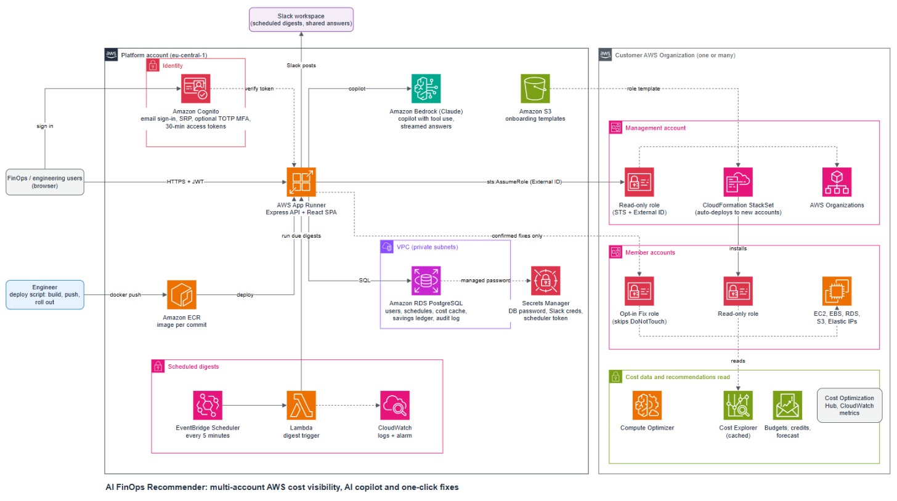

# AI FinOps Recommender

A multi-account AWS cost optimisation platform. An organisation connects with one read-only CloudFormation stack. The app then shows where the money goes and what changed, ranks savings by monthly impact, lets a person apply common fixes safely, posts scheduled Slack digests, and answers cost questions through an AI copilot (Claude on Amazon Bedrock) that queries the customer's live AWS data.

> This repository documents the architecture and design of a production system I built. The source code is private.

The editable diagram is in [`architecture.drawio`](architecture.drawio) (open it in app.diagrams.net).

## What it does

| Area | Capability |
|---|---|
| Overview | Month-to-date spend against last month and budget, forecast, credits, cost spikes, what moved the bill, savings ranked by monthly impact, a FinOps health score |
| Explore costs | Any date range grouped by service, account, region, usage type or tag, with drill-down, a spend calendar and CSV export |
| Savings | Idle and underused EC2/RDS, gp2 to gp3, unattached EBS, old snapshots, unused Elastic IPs, S3 storage classes, data transfer, Compute Optimizer and Cost Optimization Hub recommendations |
| Fix costs | One-click fixes (stop idle EC2/RDS with Undo, gp2 to gp3, snapshot then delete volumes, delete old snapshots, release EIPs). Each fix needs a person to confirm in the UI, runs through a separate opt-in role that never touches resources tagged `DoNotTouch`, and is written to an audit log and a savings ledger |
| AI copilot | Claude on Amazon Bedrock with live tools over the customer's cost and resource data. Answers stream, cite the data they used, suggest follow-ups, and can be pinned or shared to Slack |
| Slack | One-click Slack app install (OAuth, encrypted bot tokens) or an incoming webhook. Scheduled digests (daily, weekdays, weekly, monthly, first working day) in each schedule's own time zone, with an "only when something needs attention" mode and delivery history |
| Connection health | Probes what the connected role can read and says which IAM permission or AWS setting unlocks anything missing |
| Reports | Branded PDF of spend, savings and next steps |

## Architecture

**Front end and API.** A React 18 single-page app and an Express API ship as one container. The image is built per commit, pushed to **Amazon ECR** and rolled out on **AWS App Runner** (1 vCPU / 2 GB with VPC egress). App Runner keeps the previous version if a new one fails to start.

**Authentication with Amazon Cognito.** A Cognito user pool, defined in CloudFormation:
- Email is the username and is verified automatically.
- Password policy with a 10-character minimum.
- Optional TOTP MFA with an authenticator app.
- SRP sign-in, so the password never travels to the API.
- 30-minute access tokens and 7-day refresh tokens, revoked on sign-out.
- User-existence errors are suppressed to prevent account enumeration.

The API verifies Cognito JWTs on every request. Existing users from an earlier built-in login were migrated into Cognito.

**Data.** **Amazon RDS for PostgreSQL** sits in private subnets. Its master password is managed by RDS in **Secrets Manager**. It holds users, organisations, schedules, the Cost Explorer response cache, the savings ledger and the fix audit log. Cost Explorer charges USD 0.01 per API call, so every call is cached and counted.

**Customer onboarding.** The customer deploys a CloudFormation template, hosted in S3, in the management account:
- It creates a **read-only IAM role** that the platform assumes with **STS** and a per-organisation **External ID**, which prevents confused-deputy attacks.
- A **service-managed StackSet** installs the same role in every member account and in new accounts automatically.
- A separate, optional **Fix role** enables the one-click fixes.

**AI copilot.** The API runs a Claude tool-use loop on **Amazon Bedrock** with up to 8 tool rounds per answer. The tools query Cost Explorer, Budgets, Compute Optimizer, Cost Optimization Hub, CloudWatch and resource inventories in the customer's accounts. Answers stream back to the browser.

**Scheduled digests.** App Runner only gives an instance CPU while it serves a request, so in-app timers would stall. Instead, **EventBridge Scheduler** invokes a small **Lambda** every 5 minutes. The Lambda calls an internal API endpoint with a token from Secrets Manager, and the app sends whichever digests are due. A **CloudWatch** alarm watches for failures.

**Security notes.**
- Customer access is read-only by default. Write access is opt-in, scoped, confirmed by a person and audited.
- A Content-Security-Policy allows only the app's own scripts.
- Slack bot tokens are encrypted at rest with a key held in Secrets Manager.
- No long-lived customer credentials are stored.

## Tech stack

Node.js (Express), React 18 + Vite, PostgreSQL, Docker, AWS App Runner, ECR, RDS, Cognito, Bedrock (Claude), STS, CloudFormation (StackSets), Lambda, EventBridge Scheduler, Secrets Manager, CloudWatch, S3, Cost Explorer, Budgets, Compute Optimizer, Cost Optimization Hub, Organizations, Slack API.

## LinkedIn / resume summary

**AI FinOps Recommender (AWS, Bedrock, Cognito).** Built a multi-account AWS cost optimisation platform: customers onboard with a read-only cross-account role deployed by CloudFormation StackSets (STS with External ID). The app surfaces spend trends, forecasts and ranked savings, and an AI copilot (Claude on Amazon Bedrock with tool use) answers cost questions from live AWS data. Fixes run with one click, each confirmed by a person, through an opt-in role and logged in an audit trail. Scheduled Slack digests run via EventBridge Scheduler and Lambda. Runs as a container on App Runner with RDS PostgreSQL. Sign-in uses Amazon Cognito with SRP, optional TOTP MFA and short-lived tokens. Cost Explorer calls are cached to keep API costs down.
